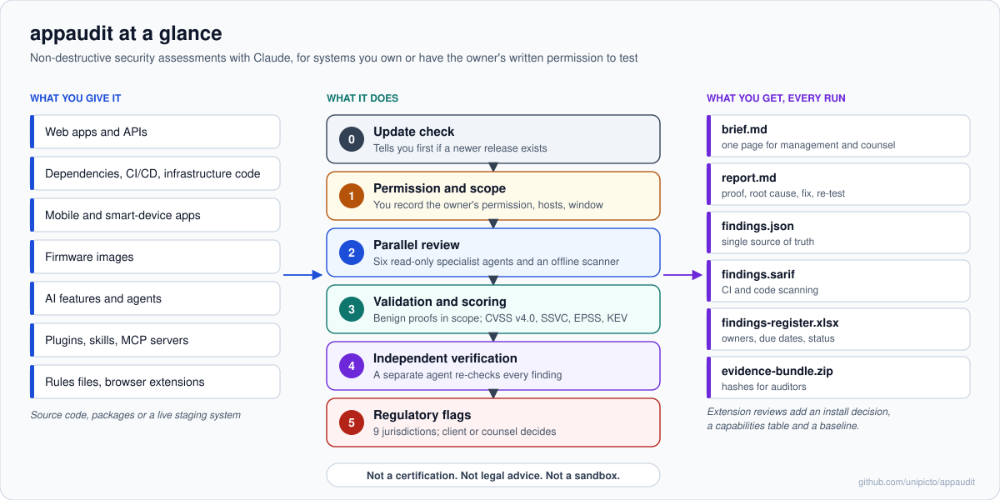
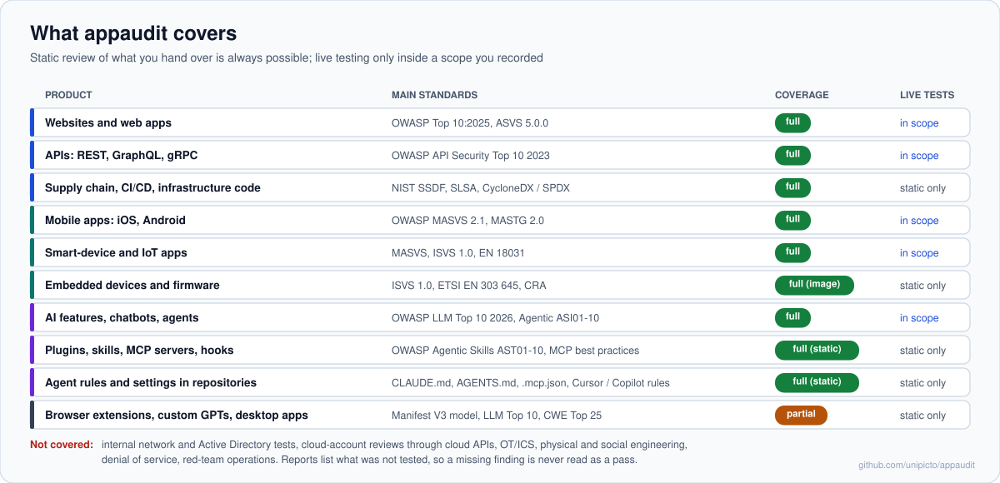
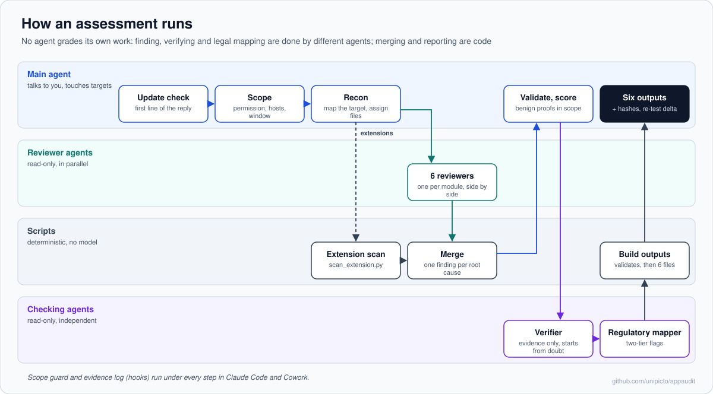
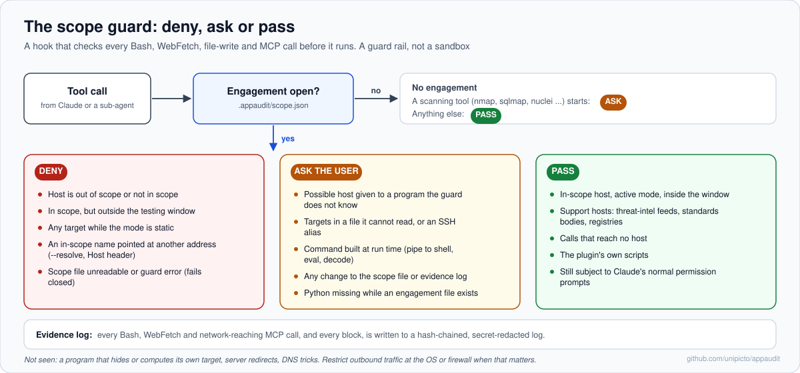
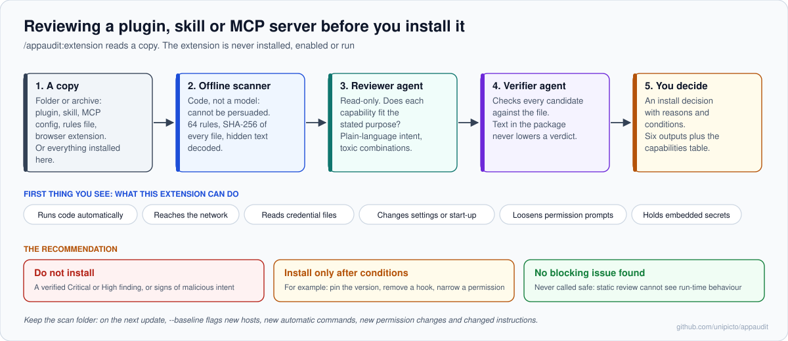

# appaudit

**Non-destructive security assessments with Claude, for systems you own or have the owner's
written permission to test.** Web apps, APIs and supply chains, mobile and IoT apps, embedded firmware, AI/LLM agents, and the plugins, skills and MCP
servers you add to your AI agent — checked before you install them. appaudit enforces the
engagement scope, keeps a hash-chained evidence log, has every finding checked by an independent
agent, flags regulatory deadlines in 9 jurisdictions, and delivers six audit-ready outputs
every run.

[](https://github.com/unipicto/appaudit/actions/workflows/ci.yml)


> Use appaudit only on systems you own or have the owner's **written** permission to test.
> **"Authorization" in appaudit always means that permission**: the system owner gives it, you
> record it (basis and reference) before any live test, and appaudit enforces the scope you
> recorded. appaudit does not grant, verify or certify authorization, and its outputs are not a
> certification. It is a tool for qualified people: it does not replace the assessor's
> judgment, legal counsel or a certification body.

<p align="center"></p>

---

## What it does

| | |
|---|---|
| **Permission gate** | No live test until you record the owner's permission (basis and reference), the scope, the window and the mode. Static review of code, configuration and firmware you have is always allowed |
| **Scope guard** (plugin) | Blocks Bash, WebFetch and MCP calls that would contact a host outside the scope, outside the window, or any target in static mode. Asks you when it cannot tell (unknown programs, target lists it cannot read, commands built at run time) and before a scanning tool starts with no engagement open. Fails closed |
| **Parallel specialist review** (plugin) | Six read-only reviewer agents (web, API & supply chain, mobile, firmware, AI agents, agent extensions) run side by side; their candidates are merged by root cause |
| **Extension review** | `/appaudit:extension` checks a plugin, skill, MCP server or config, rules file or browser extension **before you install it**: an offline scanner (64 rules, never runs the code) lists what it can do, a reviewer agent judges whether that fits its stated purpose, the verifier checks the evidence, and you get an install decision plus a baseline for reviewing updates |
| **Current standards** | OWASP Top 10:2025, ASVS 5.0.0, API Top 10 2023, MASVS 2.1 / MASTG 2.0, ISVS 1.0, ETSI EN 303 645, EN 18031, OWASP LLM Top 10 2026, Agentic ASI01–10 and AST01–10, MCP Security Best Practices, NIST SP 800-63B-4, IR 8547 (PQC) |
| **Scoring and priority** | CVSS v4.0 (CVSS-BTE) with a verification link, CISA SSVC decision, EPSS v4, CISA KEV; remediation timelines mapped to BOD 26-04 / PCI DSS 6.3.3 or labelled organisation-defined |
| **Independent verification** (plugin) | A verifier agent re-checks every finding against its evidence; confidence can never exceed its verdict |
| **Regulatory flags** | EU, Netherlands, US federal + New York, UK, Canada, Australia, Singapore, Japan, India; China testing-law and disclosure warnings. Two tiers: *may trigger now* / *readiness*. Client or counsel decides |
| **Evidence** (plugin) | Hash-chained, secret-redacted log of every network-reaching action; independent chain verification |
| **Re-test** | Compares a re-test with the previous run: fixed, new, persisting, risk-accepted, not re-tested |
| **Update check first** | Every assessment starts by checking this repository for a newer release and flags bundled data older than 90 days. Nothing is installed automatically |

## What you get every run

| File | For | Contents |
|------|-----|----------|
| `brief.md` | Board, management, counsel | One page: deadlines that may be running, posture, top risks, decisions needed, readiness, coverage, integrity |
| `report.md` | Engineers, the assessor's file | Every finding with benign proof, root cause, impact, copy-paste fix, re-test step, regulatory register, disclosure routing |
| `findings.json` | Pipelines, archive, re-tests | The single source of truth ([schema](skills/assess/references/findings.schema.json)) |
| `findings.sarif` | CI, GitHub code scanning, IDEs | SARIF 2.1.0 code findings |
| `findings-register.xlsx` | Remediation owners | Findings and regulatory sheets with owner, due date, status, re-test |
| `evidence-bundle.zip` | Auditors | Findings, scope, evidence log, chain verification, inner SHA-256 manifest |

Plus `update-check.json`, `MANIFEST.sha256` (hash of every file), for re-tests `delta.md`, and for
extension reviews `capabilities.md` (what the extension can do) and `inventory.json` (every file
hashed: the baseline for its next update).
See a [sample run](docs/examples/sample-run/) built from the worked example.

## What it covers

<p align="center"></p>

Details per product, what to provide and how to start: [coverage guide](docs/COVERAGE-GUIDE.md).

## How it works

<p align="center"></p>

Every tool call passes the scope guard first:

<p align="center"></p>

Plugins, skills and MCP servers are reviewed before you install them:

<p align="center"></p>

## What it cannot do

- It is **not a sandbox**: the scope guard reads commands and URLs. It asks when it cannot tell,
  but a program that hides its target is not seen. Add OS-level egress rules when that matters.
  Known bypasses are listed in the [threat model](docs/THREAT-MODEL.md).
- Enforcement (hooks, evidence chain, sub-agents) exists **only in Claude Code and Cowork**.
- It does **not exploit**, persist, evade, brute-force or run denial of service.
- It does **not give legal advice**, decide notifications, or certify anything.
- It does **not compute CVSS scores** itself (the FIRST calculator does) and does not prove that
  untested areas are secure.
- Extension reviews are **static**: appaudit never runs the extension, so run-time behaviour, tool
  descriptions served by remote MCP servers and packages downloaded later need the optional isolated
  test described in the [coverage guide](docs/COVERAGE-GUIDE.md#45-what-is-left-for-you). A clean scan is
  not proof of safety.

What you still have to check before a report goes out is listed in the
[user manual, section 9](docs/USER-MANUAL.md#9-what-you-must-check-yourself).

## Install

| Where | Package | How |
|-------|---------|-----|
| **Claude Code** (full enforcement) | plugin | `/plugin marketplace add unipicto/appaudit` then `/plugin install appaudit@unipicto` |
| **Cowork** (Claude desktop app) | `appaudit-<v>.plugin` | Download from [Releases](https://github.com/unipicto/appaudit/releases), verify the hash, add it on the plugins page |
| **claude.ai** | `appaudit-skill-<v>.zip` | Settings → Capabilities → Skills → upload |
| **OpenAI Codex, Gemini CLI, GitHub Copilot, Cursor** | `appaudit-skill-<v>.zip` | Unzip into the tool's skills folder |
| **ChatGPT, Gemini, Grok, any API** | `appaudit-portable-<v>.zip` | System prompt + 10 knowledge files; see [OTHER-ASSISTANTS.md](docs/OTHER-ASSISTANTS.md) |

Requirements: Python 3.9+ (standard library only) for the hooks and scripts; Git for Windows
on Windows. Install the plugin **or** the skill in one app, not both.

## Quick start

```text
"Do a security review of this repository."     → update check, then static review
/appaudit:scope                                → authorization, hosts, window, mode, jurisdictions
"Now validate the findings on staging."        → active checks, inside scope only
/appaudit:report                               → verifier, regulatory mapper, six outputs
/appaudit:retest                               → after fixes: what changed
/appaudit:extension ~/Downloads/plugin.zip      → before installing a plugin, skill or MCP server
/appaudit:extension installed                   → review what is installed on this machine
```

What each product type needs and how to start: [coverage guide](docs/COVERAGE-GUIDE.md).

## Use in GitHub Actions

The extension scanner also runs as a GitHub Action. It reads the files only: nothing from the scanned
folder is executed, and nothing is sent anywhere.

```yaml
permissions:
  contents: read
steps:
  - uses: actions/checkout@v7
  - uses: unipicto/appaudit@v4          # pin to a commit SHA in production
    with:
      path: .                           # a plugin, a skill folder or a whole repository
      fail-on: High                     # Critical, High, Medium, Low, Informational or none
```

| Input | Default | Meaning |
|-------|---------|---------|
| `path` | `.` | Folder or archive to scan |
| `name` | `extension` | Short name used in the report |
| `fail-on` | `High` | Fail the step at or above this severity; `none` never fails |
| `baseline` | | `inventory.json` of the version you reviewed before: flags new hosts, new automatic commands, changed instructions |
| `ignore-file` | | JSON list of accepted candidates, each `{rule, path, reason}` |
| `output-dir` | runner temp | Where `capabilities.md`, `inventory.json`, `candidates.json` and `candidates.sarif` are written |

Outputs: `decision` (`no_blocking_issue_found`, `review_first`, `do_not_install_yet`) and `sarif` (path of the SARIF
file, for `github/codeql-action/upload-sarif`). The capabilities table appears in the job summary. The rules are listed in
[module-agent-extensions.md](skills/assess/references/module-agent-extensions.md); a clean result means no
blocking issue was found by static review, not that the code is safe.

## Components

| Type | Name | Purpose |
|------|------|---------|
| Skill | `/appaudit:assess` | The assessment playbook (triggers on any security-review request) |
| Skill | `/appaudit:scope` | Create, show, change or close the engagement scope |
| Skill | `/appaudit:intel` | KEV, EPSS and NVD lookups for CVE IDs |
| Skill | `/appaudit:report` | Verification, regulatory mapping and the six outputs |
| Skill | `/appaudit:retest` | Re-test and comparison with the previous run |
| Skill | `/appaudit:extension` | Review a plugin, skill, MCP server or config, rules file or browser extension before installing or updating it |
| Agents | `web-reviewer`, `api-supply-chain-reviewer`, `mobile-reviewer`, `firmware-reviewer`, `ai-agent-reviewer`, `extension-reviewer` | Parallel, read-only domain review |
| Agent | `verifier` | Independent check of every finding |
| Agent | `regulatory-mapper` | Two-tier regulatory flags from the jurisdiction profile |
| Hooks | SessionStart, PreToolUse scope guard, PostToolUse evidence log | Context, enforcement, evidence |
| GitHub Action | `uses: unipicto/appaudit@v4` | Runs the extension scanner in CI: capabilities report in the job summary, SARIF, severity gate |
| Scripts | `check_update`, `scan_extension`, `merge_candidates`, `build_outputs`, `compare_runs`, `vuln_intel`, `verify_evidence` | Deterministic steps, standard library only |

## Documentation

- [User manual](docs/USER-MANUAL.md) — install, every step, every output, regulatory coverage,
  limits, checklist, troubleshooting
- [Coverage guide](docs/COVERAGE-GUIDE.md) — every product type: what is checked, what to provide,
  how to start, what is left to you; extension reviews in detail
- [How it works](docs/HOW-IT-WORKS.md) — workflow, multi-agent design, enforcement and its limits
- [Threat model](docs/THREAT-MODEL.md) — what appaudit protects against, what it does not, known bypasses
- [Other assistants](docs/OTHER-ASSISTANTS.md) — ChatGPT, Gemini, Grok, Codex, Copilot, Cursor
- [Publishing](docs/PUBLISHING.md) — maintainers: release process
- [Changelog](CHANGELOG.md) · [Security policy](SECURITY.md) · [Contributing](CONTRIBUTING.md)

## Why appaudit

AI agents can now run real security tooling. That makes three things essential that a prompt
alone does not give you: a hard stop at the edge of the authorized scope, evidence an auditor
can verify, and findings that someone other than their author has checked. appaudit adds those
to Claude, and turns the result into the documents clients, engineers, auditors and counsel
actually use, with the regulatory deadlines that may already be running at the top.

## License

[Apache License 2.0](LICENSE). See [NOTICE](NOTICE) for third-party standards referenced.
The regulatory summaries are orientation, not legal advice; the official texts prevail.
