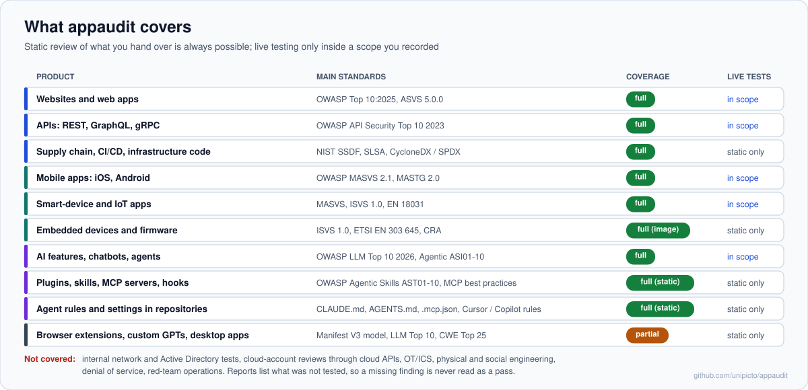
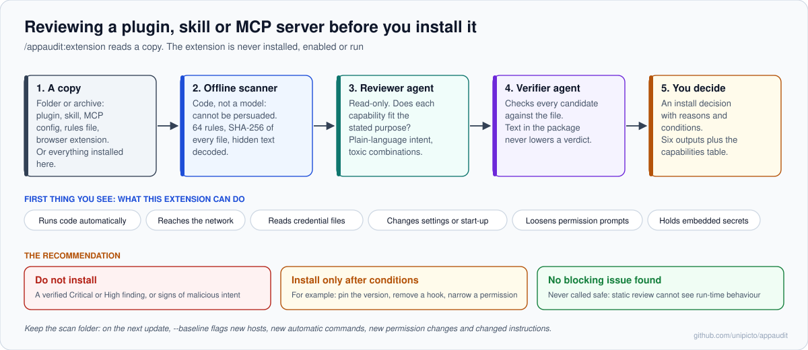

# Coverage guide — what appaudit checks, and how to run it for each product

Version 4.4.2. This guide answers three questions for every kind of product appaudit covers:
**what is checked**, **what you provide**, and **how to start**. For installation and the outputs
see the [user manual](USER-MANUAL.md); for the architecture see [HOW-IT-WORKS.md](HOW-IT-WORKS.md).

Use appaudit only on systems you own or have the owner's written permission to test (that
permission is what "authorization" means in appaudit; you record it, appaudit does not grant or verify it). Reviewing a copy of
something you obtained (source code, an app package, a firmware image, a plugin) is static review
and needs no authorization gate; anything that sends traffic to a live system does.

---

## 1. Coverage at a glance



| Product | Coverage | Module(s) | Static (files you give) | Active (live, in scope) | Main standards |
|---------|----------|-----------|-------------------------|-------------------------|----------------|
| Websites and web applications | Full | web, api-supply-chain | Source, configuration, front-end bundle | Benign probes of auth, access control, injection, headers, session, client-side | OWASP Top 10:2025, ASVS 5.0.0 |
| APIs (REST, GraphQL, gRPC, webhooks) | Full | api-supply-chain | OpenAPI/GraphQL schemas, gateway config, source | Object/function-level authorization, rate limits, mass assignment | OWASP API Security Top 10 2023 |
| Software supply chain (dependencies, SBOM, secrets, CI/CD, IaC, containers, Kubernetes) | Full | api-supply-chain | Lockfiles, SBOMs, pipelines, Terraform/Helm/manifests, Dockerfiles | — (no cloud-account access) | NIST SSDF, SLSA, OpenSSF Scorecard, CycloneDX/SPDX, CIS 7 |
| Mobile apps (iOS, Android) | Full | mobile-smart-device, api-supply-chain | APK/AAB/IPA, decompiled code, manifests | On a test device you control | OWASP MASVS 2.1 / MASTG 2.0 / MASWE |
| Smart-device and IoT companion apps (BLE, MQTT, cloud APIs) | Full | mobile-smart-device, api-supply-chain, hardware-firmware | App package, protocol captures, cloud API specs | Your own test device and account | MASVS, ISVS 1.0, EN 18031 |
| Embedded devices and firmware | Full (image); partial (hardware) | hardware-firmware | Firmware images, extracted file systems, bootloader config, SBOM | Debug interfaces only by you, on your hardware | ISVS 1.0, ETSI EN 303 645, NIST IR 8259, CRA |
| AI/LLM features, chatbots, RAG, agents | Full | ai-agent (+ web, api) | Prompts, tool manifests, agent code, retrieval config | Benign marker prompts against your deployment | OWASP LLM Top 10 2026, Agentic ASI01–10 |
| **AI-agent extensions**: Claude Code/Cowork plugins and marketplaces, Agent Skills, subagents, commands, hooks, MCP servers and MCP configs, Gemini CLI and Codex extensions, MCP bundles | **Full (static)** | agent-extensions (+ api-supply-chain for server code) | The package or folder, unpacked or as an archive | None by the agent; optional isolated test by you | OWASP AST01–AST10, ASI01–10, MCP Security Best Practices |
| Agent rules and settings in repositories (CLAUDE.md, AGENTS.md, GEMINI.md, Cursor/Copilot/Windsurf rules, `.claude/settings.json`, `.mcp.json`) | Full (static) | agent-extensions | The repository | — | AST04/05, ASI01, CVE-2025-59536 class |
| Browser extensions (Chrome, Edge, Firefox) | Partial (static manifest and code patterns) | agent-extensions §F, web | Unpacked extension or `.crx`/`.xpi`/`.zip` | — | Manifest V3 permissions model, AST03/05 |
| Custom GPTs, Gemini Gems, GPT Actions | Partial | agent-extensions, ai-agent, api-supply-chain | Exported instructions, knowledge files, Action OpenAPI schema | Benign markers in your own GPT | LLM Top 10 2026, API Top 10 |
| Desktop applications and CLIs | Partial | web/api modules for the code, api-supply-chain | Source and dependencies | — | CWE Top 25, SSDF |

**Not covered:** internal network and Active Directory penetration tests, cloud-account posture
reviews through cloud APIs, OT/ICS protocol testing, physical and social-engineering tests, load or
denial-of-service tests, red-team operations, and reverse engineering of binaries whose licence
forbids it. appaudit says so in the report (`not_tested`) instead of implying coverage.

---

## 2. The same five steps for every product

| Step | What happens | Command or phrase |
|------|--------------|-------------------|
| 0 | Update check against the GitHub repository; result is the first line | automatic |
| 1 | Scope: authorization basis, in-scope assets, window, mode, jurisdictions (only for active tests) | `/appaudit:scope` |
| 2 | Review: recon, then the module reviewers in parallel; validation within scope | `/appaudit:assess` or "review …" |
| 3 | Verification, scoring, regulatory flags, six outputs | `/appaudit:report` |
| 4 | After fixes: re-test and comparison | `/appaudit:retest` |

For extensions, steps 2–3 are combined in `/appaudit:extension` (section 4).

In claude.ai and other assistants there are no hooks or sub-agents: the same steps run one after
another, the report is labelled "self-verified", and you enforce scope yourself
([OTHER-ASSISTANTS.md](OTHER-ASSISTANTS.md)).

---

## 3. Product by product

### 3.1 Websites and web applications
- **Provide:** the repository (or the built front end), web server and framework configuration, and
  for active tests a staging URL with two test accounts of different roles.
- **Start:** "Do a security review of this web application." Then `/appaudit:scope` with the staging
  host if you want findings validated live.
- **Checked:** OWASP Top 10:2025 categories, ASVS 5.0.0 requirements, authentication and session
  handling, access control (IDOR/BOLA), injection, SSRF, security headers and TLS, client-side
  storage, third-party scripts on payment pages (PCI DSS 6.4.3/11.6.1 where in scope).
- **You check:** business-logic abuse that needs domain knowledge, production-only configuration,
  WAF/CDN rules appaudit cannot see.

### 3.2 APIs
- **Provide:** OpenAPI or GraphQL schema, gateway and auth configuration, source; for active tests a
  staging base URL and tokens for two users.
- **Start:** "Review this API for security issues." / `/appaudit:scope` for live checks.
- **Checked:** API Top 10 2023 (object and function-level authorization, property-level exposure,
  resource limits, sensitive business flows, inventory, unsafe consumption of upstream APIs).
- **You check:** tenant isolation in data you could not access, rate-limit behaviour under real load.

### 3.3 Software supply chain, CI/CD and infrastructure as code
- **Provide:** lockfiles, SBOM (CycloneDX or SPDX), CI workflows, Dockerfiles, Terraform/Helm/Kubernetes manifests.
- **Start:** "Check the dependencies, pipelines and IaC in this repository."
- **Checked:** known-vulnerable and unmaintained dependencies (KEV/EPSS via `/appaudit:intel`), secrets
  in code and history, unpinned actions and images, pipeline injection, IaC misconfiguration,
  provenance (SLSA), SBOM completeness.
- **You check:** the live cloud account (IAM, exposed storage), which appaudit does not access.

### 3.4 Mobile apps
- **Provide:** APK/AAB or IPA (or source), and a test device you control for dynamic checks.
- **Start:** "Assess this Android app." The mobile and API reviewers run together.
- **Checked:** MASVS 2.1 control groups (storage, crypto, auth, network, platform, code, resilience,
  privacy) with MASTG tests and MASWE weaknesses; the backend API as in 3.2.
- **You check:** behaviour on rooted/jailbroken devices if resilience matters, store-listing claims.

### 3.5 Smart-device and IoT companion apps
- **Provide:** the app package, the device's cloud API description, BLE/MQTT captures from your own device.
- **Start:** "Review the companion app and cloud API of this smart device."
- **Checked:** pairing and provisioning, BLE/MQTT authentication and encryption, cloud API
  authorization, EN 18031 mapping for radio equipment sold in the EU.
- **You check:** radio-level behaviour that needs lab equipment.

### 3.6 Embedded devices and firmware
- **Provide:** the firmware image (or extracted file system), bootloader and update configuration, SBOM.
- **Start:** "Analyse this firmware image."
- **Checked:** ISVS 1.0, ETSI EN 303 645 provisions, default credentials, debug interfaces in
  configuration, update signing, secure boot settings, vulnerable components, CRA readiness.
- **You check:** physical interfaces (UART/JTAG/SWD), glitching and side channels; appaudit gives the
  test plan, you run it on hardware you own.

### 3.7 AI/LLM features and agents
- **Provide:** system prompts, tool definitions, agent code, retrieval configuration; for active tests
  a deployment you own.
- **Start:** "Review our support chatbot for prompt-injection and agent risks."
- **Checked:** LLM Top 10 2026, Agentic ASI01–ASI10: direct and indirect injection, output handling,
  excessive agency, confirmation gates, memory and RAG access control, multi-agent trust, budgets.
  Live validation uses benign marker payloads only.
- **You check:** model-provider terms and data handling, human-review processes around high-impact outputs.

---

## 4. AI-agent extensions — plugins, skills, MCP servers, rules files

An extension is code and instructions you invite into your agent. The code runs with your account;
the instructions steer a model that holds your tools. appaudit reviews both, **before** you install.

### 4.1 What is covered

| Extension type | Typical files | What appaudit looks at |
|----------------|---------------|------------------------|
| Claude Code / Cowork plugin, marketplace | `.claude-plugin/plugin.json`, `marketplace.json`, `skills/`, `agents/`, `commands/`, `hooks/`, `.mcp.json`, `.lsp.json`, `monitors/`, `bin/`, `settings.json` | Every component that runs code and when; every instruction; manifest hygiene; pinning |
| Agent Skill (Claude, Codex, Gemini CLI, Copilot, Cursor) | `SKILL.md`, `references/`, `scripts/`, assets | Instructions, descriptions, allowed tools, bundled scripts, hidden content |
| Subagents and commands | `agents/*.md`, `commands/*.md` / `*.toml` | Tool lists, permission modes, instructions |
| Hooks | `hooks.json`, settings, skill front matter | Events, matchers, commands, network use, background execution |
| MCP servers and configurations | `.mcp.json`, `claude_desktop_config.json`, `.cursor/mcp.json`, `.vscode/mcp.json`, Windsurf, Gemini `settings.json`, Codex `config.toml`, `.mcpb`/`.dxt` bundles | Launch commands and pinning, remote URLs and TLS, credentials, auto-approval |
| Gemini CLI extensions | `gemini-extension.json`, context files, `commands/*.toml`, hooks | MCP servers, context instructions, excluded tools |
| Rules files | `CLAUDE.md`, `AGENTS.md`, `GEMINI.md`, `.cursorrules`, `.cursor/rules/*.mdc`, `copilot-instructions.md`, `.windsurfrules` | Hidden or steering instructions that load in every session |
| Browser extensions | `manifest.json` + scripts | Host access, high-risk permissions, MV2, CSP, external messaging, remote code |
| GPT Actions | OpenAPI schema | Servers, write operations, authentication |

### 4.2 How the review works



```text
copy of the extension (folder or archive)  — never installed, never run
        │
        ▼
scan_extension.py   offline, deterministic: inventory + SHA-256 of every file,
        │           capabilities table, 64 detection rules (EXT-*), drift against a baseline
        ▼
extension-reviewer  read-only agent: purpose fit, intent in plain language,
        │           toxic combinations, scanner candidates (holds / justified / false positive)
        ▼
merge → verifier → install decision (you take it) → six outputs + capabilities.md + inventory.json
```

The scanner never executes, imports, installs or downloads anything from the target. Archives are
read in memory with size limits; links are recorded, never followed; path-traversal entries are
reported and skipped. It also checks for the bypass techniques documented by the Cloud Security
Alliance in June 2026: padding past the inspection window, compiled bytecode, instructions in office
documents and nested archives, and text that tries to talk reviewers and scanners into a low rating.

### 4.3 How to proceed

**Plugin (Claude Code or Cowork):**

```text
/appaudit:extension ~/Downloads/some-plugin.zip        one package
/appaudit:extension ./vendor/mcp-config/.mcp.json      one configuration file
/appaudit:extension installed                          list what is installed here, then choose
/appaudit:extension ./new-version --baseline .appaudit/extension-scan/some-plugin-<date>/
                                                       review an update against the version you approved
```

1. Get a copy without installing it: download the release archive, or `git clone --depth 1`.
2. Run `/appaudit:extension` on the copy. The first table you see is **What this extension can do**.
3. Read the install decision: **Do not install**, **Install only after the listed conditions**, or
   **No blocking issue found** (never "safe").
4. Keep the scan folder. Its `inventory.json` is the baseline: when the extension updates, run the
   review with `--baseline` and look at new hosts, new automatic execution and changed instructions
   before accepting the update. Pin the version you approved.

**Without the plugin (any assistant with a shell, or your own terminal):**

```bash
python3 scripts/scan_extension.py --discover                      # where extensions live on this machine
python3 scripts/scan_extension.py ./some-plugin.zip --name some-plugin --unpack ./review-copy
python3 scripts/scan_extension.py ./some-plugin-v2 --baseline .appaudit/extension-scan/some-plugin-<date>/inventory.json
python3 scripts/scan_extension.py ./my-plugin --fail-on Medium     # CI gate for your own extension
```

Then give the assistant `capabilities.md`, `candidates.json` and the files, and ask it to apply
`module-agent-extensions.md` (the portable bundle includes it in knowledge file 06).

**Without any shell (ChatGPT, Gemini, Grok web apps):** upload the extension's text files and ask for
a review with the agent-extensions module. The model reads the files and the checklist, but invisible
characters may not survive upload or display. Run the scanner locally when you can.

### 4.4 Reading the result

| You see | Means | Do |
|---------|-------|-----|
| Critical/High from EXT-C01, C03, C04, C05, C06, H02, S06 | The package can run downloaded code, read credentials, collect your environment, persist, or send data out | Do not install; report to the marketplace if it is public |
| EXT-I01 with decoded hidden text | Invisible instructions | Do not install; the decoded text shows what was hidden |
| EXT-I02/I03/I06/I10 | Instructions to override rules, hide actions, send data, or load remote instructions | Do not install unless the reviewer shows they are quoted examples |
| EXT-M01 unpinned launcher | The MCP server runs whatever version is newest at each start | Pin an exact version or image digest |
| EXT-S01/S02/S03 | The package loosens your permission prompts | Remove the settings or do not use the package |
| EXT-P03/P04 uninspected content | Binaries, compiled code or archives that could not be reviewed | Ask for source, or treat as unreviewed code |
| EXT-D01 after an update | The update adds a host, an automatic command or a permission change | Review the change before accepting |

### 4.5 What is left for you
- **Run-time behaviour.** If the decision matters and a capability is unclear, install the extension in
  a disposable container or VM with no credentials and the network blocked or captured, and record
  what it does (processes, files, connections, MCP `tools/list`). appaudit never runs it for you.
- **Remote MCP servers** send their tool descriptions only at run time; list them in that isolated
  environment and review them as instructions.
- **Packages downloaded at run time** (npx, uvx, docker) need their own review at the pinned version.
- **Publisher trust**: identity, maintenance, signed releases; appaudit flags names that pass as
  official but cannot verify a person or company.
- **Plain-language intent** that matches no pattern: read the instruction files yourself, especially
  any that the reviewer marks as purpose mismatch.

### 4.6 Use it on your own extensions
Add the scanner to CI so every release of your plugin or skill is checked before publishing; appaudit
does this for itself and fails its build on any Low-or-higher candidate:

```yaml
- uses: unipicto/appaudit@v4          # pin to a commit SHA in production
  id: scan
  with:
    path: .
    fail-on: High
    ignore-file: .github/appaudit-ignore.json   # accepted candidates, each with a reason
- uses: github/codeql-action/upload-sarif@v4    # optional: show results under Security > Code scanning
  if: always()
  with:
    sarif_file: ${{ steps.scan.outputs.sarif }}
```

The capabilities table appears in the job summary. Without Actions, run the script directly:
`python3 skills/assess/scripts/scan_extension.py dist/my-plugin.plugin --fail-on Low`.

---

## 5. What every report includes about coverage
- `not_tested` lists what was not examined, so a missing finding is never read as a pass.
- `jurisdictions_not_assessed` lists the jurisdictions outside the profile.
- Extension reviews attach `capabilities.md` and `inventory.json` (package digest = the exact version reviewed).

## 6. What you must check yourself (all products)
See [user manual §9](USER-MANUAL.md#9-what-you-must-check-yourself). In short: authorization
evidence, scope boundaries, CVSS scores in the FIRST calculator, regulatory decisions with counsel,
redaction before sharing, and the areas listed under `not_tested`.
