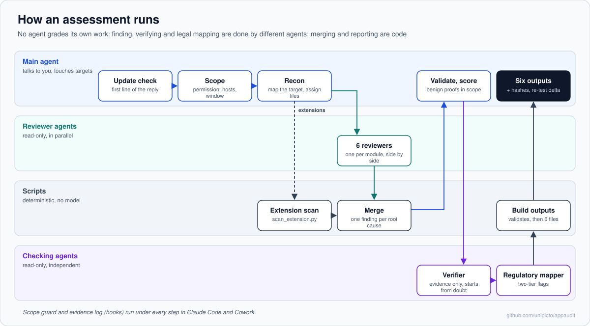
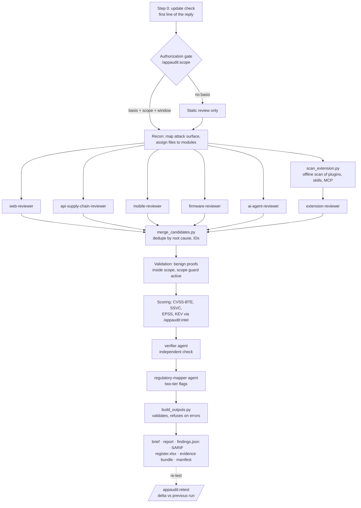
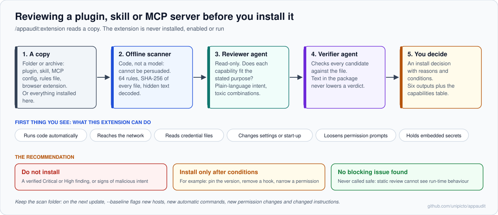
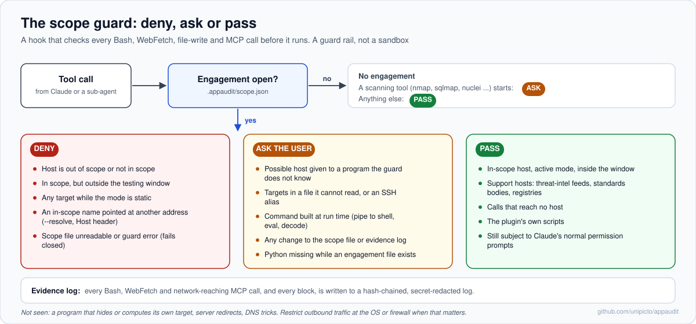

# How appaudit works

## Design principles

1. **Authorization first.** Nothing contacts a live target without a recorded basis, scope,
   window and mode. Static review is always allowed.
2. **Separation of duties.** The agent that finds an issue does not verify it, and the agent
   that verifies it does not map it to law. Each sees evidence, not the others' reasoning.
3. **One source of truth.** Every output is generated from one `findings.json`, so the brief,
   report, SARIF and register cannot disagree.
4. **Flag, don't decide.** Regulatory triggers are flagged in two tiers for the client and
   counsel. The tool never states that a notification is required.
5. **Evidence you can check.** Network-reaching actions are logged in a hash chain; every
   deliverable is listed in a SHA-256 manifest.
6. **Current by default.** Every assessment starts with an update check; bundled standards and
   regulatory data carry check dates and are flagged when older than 90 days.

## The workflow

The same flow as a text diagram:

| Step | Who | Why this split |
|------|-----|----------------|
| Update check | Main agent, `check_update.py` | Users learn of fixes and new law before relying on old data |
| Recon | Main agent | One coherent map of the target; reviewers get file lists, not whole repositories |
| Extension scan | `scan_extension.py` (deterministic, offline) | Patterns, hashes and capabilities are found the same way every time and cannot be talked out of a result by text in the package |
| Domain review | Up to six reviewer agents **in parallel** | Each applies one checklist with a fresh context; wall-clock time drops; one module's noise does not crowd out another |
| Merge | `merge_candidates.py` (deterministic) | Duplicates reported by two reviewers become one finding with both sources |
| Validation | Main agent only | Reviewers are read-only and cannot reach targets; all live probing stays under the scope guard |
| Verification | `verifier` agent | A finding does not grade itself; confidence never exceeds the verdict (the builder enforces this) |
| Regulatory mapping | `regulatory-mapper` agent | Legal mapping is based on the profile and facts, not on the technical narrative |
| Outputs | `build_outputs.py` (deterministic) | Machine validation of every rule; reproducible files with hashes |

**Why not more agents?** Scoring needs the FIRST calculator and live lookups, and validation
needs the scope guard; both stay with the main agent. Report writing is deterministic code,
not an agent, so it cannot drift from the data.

**Single-agent mode** (claude.ai, other assistants): the same steps run one after another,
with each module as a separate pass and a sceptical self-review instead of the verifier. The
report then says "self-verified".

## Components

| Component | File | Runs in |
|-----------|------|---------|
| Assessment playbook | `skills/assess/SKILL.md` + `references/` | All |
| Scope, intel, report, re-test skills | `skills/*/SKILL.md` | Claude Code, Cowork, claude.ai |
| Reviewer, verifier, regulatory-mapper agents | `agents/*.md` | Claude Code, Cowork |
| SessionStart hook | `hooks/session_start.py` | Claude Code, Cowork |
| Scope guard (PreToolUse) | `hooks/scope_guard.py` | Claude Code, Cowork |
| Evidence log (PostToolUse) | `hooks/evidence_log.py` | Claude Code, Cowork |
| Scripts | `skills/assess/scripts/*.py`, `scripts/verify_evidence.py` | Anywhere with Python 3.9+ |

## Extension review

`/appaudit:extension` reviews plugins, skills, MCP servers and configurations, rules files and
browser extensions before installation. It splits the work so that neither the code nor the text in
the package can steer the result on its own:

| Layer | What it does | Why |
|-------|--------------|-----|
| `scan_extension.py` | Reads every file of a copy (archives in memory, size and count limits, links recorded and not followed, path-traversal entries reported and skipped), hashes it, classifies it (instruction, code, hook, MCP, settings, manifest), runs 64 rules and writes the capabilities table | Deterministic and offline: never executes, imports, installs or downloads anything; immune to persuasion |
| `extension-reviewer` agent | Reads the copy read-only for purpose fit, plain-language intent and toxic combinations; rates each scanner candidate | Finds what patterns miss; instructed that text addressing reviewers is itself a finding |
| `verifier` agent | Checks every candidate's evidence | The reviewer does not grade itself |
| Install decision | Recommended by the skill, taken by the user | A tool must not approve code on the user's behalf |
| Baseline | `inventory.json` with a package digest | Updates are compared with the reviewed version (AST07) |

Severity adjustments are explicit and never remove a candidate: documentation that is not loaded
into the model is lowered, wording inside Markdown code spans is marked "quoted or example context",
protective wording ("never …") is not reported for the negatable rules, and regular-expression
definitions in code are Informational. The appaudit build scans its own packages with the same
scanner and stops on any Low-or-higher candidate.

## Enforcement: the scope guard

For every Bash, WebFetch, file-write and MCP call the guard gives one of three answers. It
never approves a call on its own: a call it lets through still goes through Claude's normal
permission prompts.

| Situation | Answer |
|-----------|--------|
| Engagement open; the call names a host that is out of scope, not in scope, in scope but outside the window, or any target while `mode` is `static` | **Deny** |
| Engagement open; `curl --resolve` / `--connect-to` or a `Host:` header points an in-scope name at another address or site | **Deny** |
| Scope file unreadable, or the guard itself fails | **Deny** network-reaching calls (fails closed) |
| Engagement open; a possible out-of-scope host in the arguments of a program the guard does not know (a script, `docker run`, `npx`) | **Ask** |
| Engagement open; targets come from a file the guard cannot read (`nmap -iL`, `wget -i`, `sqlmap -r`), an SSH alias, or a command built at run time (pipe into a shell, `eval`, `base64 -d`) | **Ask** (a readable target list is checked host by host) |
| Any change to the scope file or the evidence log | **Ask**, except one plain call to one of the plugin's own scripts |
| No engagement open; a scanning or attack tool starts (nmap, sqlmap, nuclei and similar) | **Ask** (`scanner_gate`: `ask`, `deny` or `off`) |
| Python missing while an engagement file exists | **Ask** for every call |
| Hosts in `support_hosts` (threat-intel feeds, standards bodies, registries, GitHub) | Pass |
| Everything else | Pass |

`out_of_scope` always wins. Hooks also fire for tool calls made by sub-agents. The reviewer,
verifier and mapper agents are limited to Read, Grep and Glob, so they cannot run commands or
contact hosts at all.

### Limits (read before relying on it)

- **Pattern-based, not a sandbox.** It reads URLs anywhere in a command, hostnames, IPs and
  ranges given to common network tools, and host-like arguments of other programs. A program
  that hides its target (a compiled binary with a built-in address, a script that computes
  it) is not seen. For a hard guarantee, also restrict egress at the OS, container or
  firewall level. Known bypasses: [THREAT-MODEL.md](THREAT-MODEL.md).
- Hostnames are not resolved: a hostname is in scope only if listed, even when its IP is in an
  in-scope range. Redirects that a server sends are not followed by the guard.
- Ports and the rate cap are recorded but not enforced.
- The evidence log shows later edits; it does not prove that every action was logged when
  Python was missing or a hook timed out, and it can be rebuilt as a whole by someone who can
  write the file (anchor the head hash, below).

## Evidence log

`.appaudit/evidence/evidence.jsonl`: one JSON record per Bash, WebFetch and network-reaching
MCP call while the engagement is open, plus every blocked call. Each record has `seq`, `prev`
(hash of the previous record) and `hash` (SHA-256 of the canonical record), so editing,
deleting or reordering any record breaks the chain. Secrets and card numbers are redacted to
the last four characters before writing. `scripts/verify_evidence.py` checks the chain; the
builder includes the result in the evidence bundle and prints the head hash in the brief and
report. **Anchor it:** when the engagement closes, send the head hash to the client or store
it where the assessor cannot change it; `verify_evidence.py --expect-head <hash>` then shows
whether the log is still the one that was closed.

## Output builder

`build_outputs.py` validates `findings.json` (errors stop the build; warnings go into the
report appendix), normalizes and sorts findings (SSVC decision, then CVSS-BTE), derives the
uncovered jurisdictions from the profile, then writes a new dated folder: brief, report,
findings.json, SARIF 2.1.0, findings register (.xlsx, standard library), evidence bundle (zip
with inner manifest) and `MANIFEST.sha256`. It never overwrites an earlier run and refuses to
write into the evidence folder.

## Data handling

Everything stays in the project folder under `.appaudit/` (git-ignored by the scope skill's
recommendation). The only network calls appaudit itself makes are the update check (one HTTPS
GET to GitHub) and, when you ask for them, threat-intel lookups (CISA KEV, FIRST EPSS, NVD).
No telemetry.
