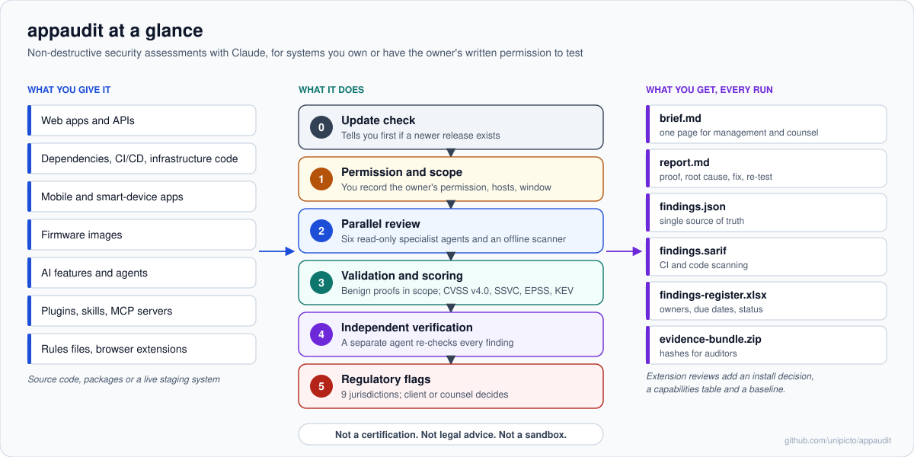

# appaudit user manual

Version 4.4.2. For the architecture see [HOW-IT-WORKS.md](HOW-IT-WORKS.md); for what each product
type needs see [COVERAGE-GUIDE.md](COVERAGE-GUIDE.md); for ChatGPT, Gemini, Grok and coding agents
see [OTHER-ASSISTANTS.md](OTHER-ASSISTANTS.md).

**Contents**
1. [What appaudit is](#1-what-appaudit-is)
2. [Install](#2-install)
3. [Set up once](#3-set-up-once)
4. [Quick start](#4-quick-start)
5. [Running an assessment step by step](#5-running-an-assessment-step-by-step)
6. [The outputs](#6-the-outputs)
7. [Regulatory coverage](#7-regulatory-coverage)
8. [What appaudit cannot do](#8-what-appaudit-cannot-do)
9. [What you must check yourself](#9-what-you-must-check-yourself)
10. [Troubleshooting](#10-troubleshooting)
11. [FAQ](#11-faq)
12. [Removing appaudit and its data](#12-removing-appaudit-and-its-data)

---

## 1. What appaudit is



A Claude plugin (and a portable skill) for **non-destructive** security
assessments of web applications, APIs, software supply chains, mobile and smart-device apps,
embedded firmware and AI/LLM agents, and for reviewing AI-agent extensions (plugins, skills, MCP
servers and configurations, rules files, browser extensions) before you install them. It:

- refuses active testing without a recorded authorization, scope, window and mode, and blocks
  tool calls to hosts outside that scope (plugin);
- reviews each technical area against current standards (OWASP Top 10:2025, ASVS 5.0.0, API
  Top 10, MASVS 2.1, ISVS 1.0, ETSI EN 303 645, OWASP LLM Top 10 2026, Agentic ASI01–10 and
  others), with parallel specialist agents;
- validates findings with benign proofs, scores them with CVSS v4.0 (CVSS-BTE), prioritizes
  with CISA SSVC, EPSS and KEV, and has each one checked by an independent verifier;
- flags regulatory obligations a finding may trigger in 9 jurisdictions (plus China warnings);
- produces six audit-ready outputs every run, all from one data file, with hashes.

**What "authorization" means here.** Permission to test, given by the owner of the system
(or by someone entitled to act for them, such as a client under a signed statement of work or a
bug-bounty programme). You record its basis and reference with `/appaudit:scope`; appaudit then
refuses live tests outside what you recorded. appaudit does not grant, check or certify that
permission: whether it is valid is your responsibility (section 9).

It is a **tool for qualified people**. It does not replace the assessor's judgment, the
client's legal counsel or a certification body.

## 2. Install

Install the plugin **or** the standalone skill in one app, not both: they would compete for
the same requests.

### Claude Code (recommended: full enforcement)

```text
/plugin marketplace add unipicto/appaudit
/plugin install appaudit@unipicto
```

Restart Claude Code when asked. Check with `/plugin` that `appaudit` is enabled. To update:
`/plugin marketplace update unipicto`, then reinstall or enable the new version. Offline or
pinned installs: download `appaudit-<version>.plugin` from the
[releases page](https://github.com/unipicto/appaudit/releases), verify its hash (section 6.8)
and install it from the file.

### Cowork (Claude desktop app)

Download `appaudit-<version>.plugin` from the releases page, verify the hash, and add it from
the plugins page of the Claude desktop app. Hooks and agents run in Cowork as in Claude Code.

### claude.ai (web, desktop chat, mobile)

Download `appaudit-skill-<version>.zip` and upload it as a skill in Settings (Capabilities →
Skills). Hooks and sub-agents do not run here: the skill applies the authorization gate and
guardrails by instruction, and runs the verification as a separate self-review.

### Other assistants

See [OTHER-ASSISTANTS.md](OTHER-ASSISTANTS.md) (ChatGPT, Gemini, Grok, OpenAI Codex, Gemini CLI,
GitHub Copilot, Cursor, APIs).

## 3. Set up once

| Item | Why | How |
|------|-----|-----|
| Python 3.9 or newer on `PATH` as `python3` or `python` | Hooks and scripts (standard library only, no packages) | Without Python the SessionStart hook warns you and the evidence log does not run. The scope guard then cannot check calls: while an engagement file exists it asks you to approve every tool call instead |
| Windows: Git for Windows | Claude Code runs hook commands in Git Bash; the hooks use `\|\|` to fall back from `python3` to `python` | Install Git for Windows |
| `.appaudit/` in `.gitignore` | Evidence and reports can contain sensitive data | The scope skill offers to add it |
| Plugin option `update_source` (optional) | The update check source | Default: this repository. Set `off` to disable (air-gapped work) |
| Plugin option `scanner_gate` (optional) | What happens when a scanning or attack tool (nmap, sqlmap, nuclei and similar) starts while no engagement is open | `ask` (default) asks you first; `deny` blocks; `off` disables the check |
| `NVD_API_KEY` environment variable (optional) | Faster NVD lookups (50 instead of 5 requests per 30 s) | Request a key from NVD |

## 4. Quick start

```text
1. "Do a security review of this repository."          → update check, static review starts
2. /appaudit:scope                                     → record authorization, hosts, window, mode, jurisdictions
3. "Now test the staging API within scope."            → active validation under the scope guard
4. /appaudit:report                                    → verifier, regulatory mapper, six outputs
5. (after fixes) /appaudit:retest                      → what is fixed, new, persisting
```

Steps 2–3 are needed only for **active** testing (anything that contacts a live system). A
code, configuration or firmware review needs no scope file.

## 5. Running an assessment step by step

### 5.1 Step 0 — update check (always first)

The first line of the first reply is the update result, for example:

> appaudit 4.4.2 is up to date.
> appaudit 4.5.0 is available (installed 4.4.2): see https://github.com/unipicto/appaudit/releases. Continuing with 4.4.2.

The check reads the published version from GitHub, warns if the bundled standards or
regulatory data is older than 90 days, saves the result to `.appaudit/update-check.json`
and never installs anything. The assessment continues either way. To update, follow
section 2.

### 5.2 Authorization and scope — `/appaudit:scope`

The scope skill asks for each field and shows the complete file for your confirmation. Every
write to the scope file triggers an approval prompt; that is intended.

| Field | Example | Notes |
|-------|---------|-------|
| `engagement` | `staging-webshop-2026-11` | Used for the output folder name |
| `authorization.basis` | `owner`, `signed-scope`, `rules-of-engagement`, `bug-bounty` | `active` mode needs a basis **and** a reference |
| `authorization.reference`, `granted_by`, `date` | `SOW-2026-041 §3`, name/role, date | Keep the signed document itself outside the repository |
| `in_scope.hosts` / `cidrs` | `staging.example.nl`, `*.staging.example.nl`, `203.0.113.0/28` | `*.x` covers subdomains, not the apex; hostnames are not resolved |
| `out_of_scope.hosts` / `cidrs` | `payments.staging.example.nl` | Always wins over in-scope |
| `window.start` / `end` | ISO 8601 with offset | An open end is allowed only for `owner` |
| `mode` | `active` or `static` | `static`: no contact with targets at all |
| `rate_limit_rps`, `prohibited`, `data_handling` | 10; DoS, brute force; "encrypted laptop, client CISO" | Recorded and shown at every session start |
| `jurisdiction_profile` | see below | Drives the regulatory flags and the testing-law gate |
| `support_hosts` | feeds, standards bodies, registries, GitHub | Hosts the agent may reach without them being targets |

**Jurisdiction profile** (codes: ISO 3166-1 alpha-2, `EU`, `US-NY`):

| Field | Meaning |
|-------|---------|
| `established_in` | Where the client is incorporated |
| `markets` | Where the product or service is offered |
| `sector`, `roles` | Sector and regulatory roles (vocabulary in `regulatory/index.md` §3, e.g. `controller`, `manufacturer`, `essential_entity`, `listed_us`, `sg_cii_owner`, `in_cert_in_covered`) |
| `data_subject_regions` | Where affected people live |
| `hosting_locations` | Where in-scope systems run (cloud regions count) |
| `tester_location`, `evidence_storage_location` | Where you work and store evidence |
| `counsel_confirmed` | Jurisdictions where counsel confirmed testing may proceed (needed for China-hosted targets) |

The **testing-law gate** keeps China-hosted targets out of scope unless counsel confirmed,
warns when tester and target are in different jurisdictions, and notes evidence transfers for
counsel. `/appaudit:scope show` prints the scope; `/appaudit:scope close` closes the
engagement and verifies the evidence chain.

### 5.3 The assessment — `/appaudit:assess` or plain language

Ask in your own words ("review this repo", "check our chatbot for prompt injection", "look at
this firmware image"). The skill:

1. Confirms what it can do in this environment (file access, shell, network, browser).
2. Maps the attack surface and decides which modules apply.
3. In Claude Code and Cowork, runs the applicable **reviewer agents in parallel**:
   `web-reviewer`, `api-supply-chain-reviewer`, `mobile-reviewer`, `firmware-reviewer`,
   `ai-agent-reviewer`, `extension-reviewer`. They are read-only and return candidate findings.
4. Merges duplicates by root cause (`merge_candidates.py`), then validates candidates with
   benign proofs. Live checks happen only inside the scope and window; the scope guard blocks
   everything else. A blocked call is reported, never worked around.
5. Scores each finding: CVSS v4.0 vector and FIRST-calculator score, SSVC decision, EPSS and
   KEV (`/appaudit:intel CVE-…`).

Confidence levels: **Confirmed** (benign proof executed, or a configuration that is itself the
flaw), **Likely** (visible in code but not safely exercisable), **Informational** (hardening).

### 5.4 The report — `/appaudit:report`

1. The `verifier` agent checks every finding against its evidence. Confidence never exceeds its
   verdict; rejected findings move to "verified not applicable".
2. The `regulatory-mapper` agent proposes regulatory flags from the jurisdiction profile.
3. `findings.json` is written and `build_outputs.py` builds the outputs (section 6). The build
   stops if any rule is broken (missing verdict, KEV below Attend, a flag without
   `client/counsel`) and lists what to fix.

### 5.5 Re-test — `/appaudit:retest`

Re-runs each open finding's re-test step, records results and statuses, and builds the outputs
again with a comparison to the previous run: fixed, new, persisting (with severity or SSVC
changes), risk-accepted and not re-tested, plus regulatory flag changes. A finding counts as
fixed only with a recorded re-test result.

### 5.6 Extensions — `/appaudit:extension`

Review a plugin, skill, MCP server or MCP configuration, rules file, Gemini/Codex extension or
browser extension **before installing it**, or an update before accepting it.

```text
/appaudit:extension ~/Downloads/some-plugin.zip
/appaudit:extension installed
/appaudit:extension ./some-plugin-v2 --baseline .appaudit/extension-scan/some-plugin-<date>/
```

1. **Step 0** update check, as always.
2. **Copy, not install.** Give a folder or archive. `installed` lists the known locations on this
   machine and in this project (`scan_extension.py --discover`). For a URL, download it yourself or
   let the skill clone it. The extension is never installed, enabled or run.
3. **Scan.** `scan_extension.py` reads every file (archives in memory, links recorded, unsafe paths
   skipped) and writes `capabilities.md`, `inventory.json`, `candidates.json` and `engagement.json`.
   The first thing you see is **What this extension can do**: automatic code execution, network
   hosts, remote MCP servers, credential access, persistence, permission changes, embedded secrets,
   uninspected content, instruction volume, browser permissions.
4. **Review.** The `extension-reviewer` agent reads the copy for purpose fit, plain-language intent
   and toxic combinations, and rates each scanner candidate (holds / justified / false positive).
5. **Verify and decide.** Candidates are merged, the `verifier` checks the evidence, and the skill
   recommends an install decision: **Do not install**, **Install only after the conditions**, or
   **No blocking issue found** (never "safe"). You decide.
6. **Outputs.** The six standard outputs, with the decision at the top of the brief and
   `capabilities.md` and `inventory.json` attached.
7. **Keep the baseline.** On the next update, run with `--baseline`: new hosts, new automatic
   execution, new permission changes and changed instruction files are flagged (EXT-D01/D02).

Each scan also writes `candidates.sarif` (SARIF 2.1.0). For your own extensions, accepted
candidates go in an ignore file, each with a reason (`--ignore-file`, a JSON list of
`{rule, path, reason}`); they are listed in the report as accepted, never dropped silently.
Never use an ignore file that came with someone else's package. In GitHub Actions:

```yaml
- uses: unipicto/appaudit@v4        # pin to a commit SHA in production
  with:
    path: .
    fail-on: High
    ignore-file: .github/appaudit-ignore.json
```

The rules (EXT-I, C, H, M, S, P, B, G, D) are listed in
`skills/assess/references/module-agent-extensions.md` §K, and how to read them in
[COVERAGE-GUIDE.md §4.4](COVERAGE-GUIDE.md#44-reading-the-result). Use the scanner on your own
extensions in CI with `--fail-on Low` or `--fail-on Medium`.

### 5.7 Threat intelligence — `/appaudit:intel`

`/appaudit:intel CVE-2024-3400 CVE-2023-4966` returns KEV status (with due date), EPSS v4
(probability, percentile, date), NVD CVSS and a pre-filled CVSS v4.0 calculator link.

## 6. The outputs

Every run writes a new folder `.appaudit/reports/<date>-<engagement>/`.

### 6.1 `brief.md` — one page for management and counsel

1. **Deadlines that may be running**: every `may_trigger_now` flag with instrument, deadline,
   clock start and authority. Read this first.
2. Overall posture, counts by severity and confidence, SSVC counts.
3. Top risks (at most five).
4. Decisions needed (from the assessor, every running deadline, every disclosure conflict).
5. Prepare for (`readiness` flags).
6. Coverage: jurisdictions assessed and **not assessed**, areas not tested, blocked calls.
7. Integrity and version: evidence chain result, update status, manifest.

An available update is also shown at the top. A re-test run adds a re-test line.

### 6.2 `report.md` — the technical report

Executive summary, one section per finding (identifiers, CVSS-BTE score and vector with a
verification link, SSVC decision points, EPSS, KEV, confidence and verifier verdict, location,
benign proof, root cause, impact, copy-paste remediation, timeline, re-test step, regulatory
flags, evidence record numbers), informational items, verified-not-applicable items, re-test
plan, regulatory trigger register, disclosure routing, evidence and data handling, build
checks.

### 6.3 `findings.json` — the data

The canonical file (`appaudit-findings/1`; fields in `skills/assess/references/findings-schema.md`,
JSON Schema in `findings.schema.json`, worked example in `findings-example.json`). Archive it:
it rebuilds every other output and is the input for the next re-test.

### 6.4 `findings.sarif` — for CI and GitHub code scanning

SARIF 2.1.0 with the code-located findings (non-code findings are counted in the run
properties). To show them as code-scanning alerts in the client's repository, use the example
workflow in [`docs/ci/github-code-scanning.yml`](ci/github-code-scanning.yml), with the client's
consent to store findings in the repository.

### 6.5 `findings-register.xlsx` — remediation tracking

Sheet **Findings** (owner, due date, status, re-test action and result, flags) and sheet
**Regulatory** (one row per finding × flag). Filters and frozen headers are set. Hand it to
remediation owners; feed their updates back into `findings.json` before the re-test.

### 6.6 `evidence-bundle.zip` — for auditors

`findings.json`, `scope.json`, `evidence.jsonl`, `evidence-verification.json`,
`update-check.json` and an inner `MANIFEST.sha256`. Verify the chain independently:

```bash
python3 scripts/verify_evidence.py evidence.jsonl
```

### 6.7 `update-check.json`, `MANIFEST.sha256`, `delta.md`

The Step 0 result; SHA-256 of every deliverable (`sha256sum -c MANIFEST.sha256`); the re-test
comparison when `--previous` was used.

### 6.8 Verifying a downloaded release

```bash
sha256sum -c SHA256SUMS --ignore-missing      # Linux, macOS (shasum -a 256 -c on older macOS)
Get-FileHash .\appaudit-4.4.2.plugin -Algorithm SHA256   # Windows PowerShell; compare with SHA256SUMS
```

From 4.4.1 on, the packages are reproducible: `git checkout v4.4.2` (or any later tag) followed by
`python tools/build_dist.py` gives the same `dist/SHA256SUMS` as the release on any operating
system (Python 3.9 or later). Files inside the packages are stored uncompressed for this reason,
so the downloads are about 0.5 MB each.

## 7. Regulatory coverage

Checked 2026-11-18 to 2026-11-20. Each file states its own check date; the update check warns
after 90 days.

| Jurisdiction | Main instruments (may trigger now) | Readiness (adopted or pending) |
|--------------|------------------------------------|--------------------------------|
| EU | CRA Art. 14 reporting (from 11 Sep 2026), NIS2 Art. 23, GDPR Arts. 33–34, DORA, RED DA / EN 18031 | CRA Annex I (11 Dec 2027), AI Act high-risk dates |
| Netherlands | Cyberbeveiligingswet (since 15 Aug 2026), GDPR/UAVG (AP) | — |
| United States + New York | SEC 8-K Item 1.05, FTC Safeguards, DFARS 7012, HIPAA breach rule, 23 NYCRR 500.17, NY GBL § 899-aa | CIRCIA, HIPAA Security Rule amendments |
| United Kingdom | UK GDPR, NIS Regulations 2018, PSTI | Cyber Security and Resilience Bill |
| Canada | PIPEDA, OSFI incident reporting | Critical Cyber Systems Protection Act |
| Australia | Privacy Act NDB, SOCI Part 2B, ransomware payment reporting, smart-device rules, APRA CPS 234 | — |
| Singapore | PDPA breach notification, Cybersecurity Act (CII), MAS TRM Notices | Cybersecurity Act Parts 3C/3D, MAS TRM amendments |
| Japan | APPI breach reporting, Active Cyber Defense law (since 1 Oct 2026), Telecommunications Business Act | APPI amendment (Act No. 56 of 2026) |
| India | CERT-In 6-hour reporting, RBI, SEBI CSCRF, IRDAI | DPDP Rules breach intimation (from 13 May 2027) |
| China | Warnings only: testing law, 2-day MIIT vulnerability reporting | — |
| Any other | Listed as "not assessed" in every brief | — |

**How flags work.** A flag is `may_trigger_now` only when the instrument is in force for a role
the client holds **and** the facts of the finding plausibly meet the trigger. Otherwise it is
`readiness`, or no flag. A vulnerability found by the assessor is not by itself a breach: where
a duty depends on third-party access, the flag says so. Every flag carries
`decided_by: client/counsel`.

## 8. What appaudit cannot do

- **It is not a sandbox.** The scope guard reads commands and URLs and asks when it cannot
  tell; a program that hides its target is not seen. Use OS-level egress rules when that
  matters. See [THREAT-MODEL.md](THREAT-MODEL.md) for the known bypasses.
- **The evidence chain is not a notary.** It shows later edits, but someone who can write the
  file can rebuild the whole chain. Send the head hash to the client when you close the
  engagement; `verify_evidence.py --expect-head` checks it later.
- **It does not run outside Claude Code and Cowork with enforcement.** In claude.ai and other
  assistants there are no hooks, no evidence chain and no sub-agents.
- **It does not compute CVSS scores itself.** The score comes from the FIRST calculator; an
  unscored vector is shown as "score pending".
- **It does not prove absence.** Areas not tested are listed; a missing finding is not a pass.
- **It does not exploit.** No exploit kits, persistence, evasion, DoS, brute force or
  destructive tests; proofs are benign by design.
- **It does not give legal advice or decide notifications.** It flags; counsel decides.
- **It does not certify.** Outputs are not a certification, attestation or conformity
  assessment (CRA, EUCC, PCI DSS, SOC 2, ISO 27001).
- **It cannot see what it cannot reach**: physical hardware probing, production systems you
  did not authorize, private dependencies without access.
- **Its data ages.** Standards and law change; check dates are in every file.
- **Extension reviews are static.** The extension is never run, so run-time behaviour, tool
  descriptions sent by remote MCP servers and packages downloaded at run time are not seen; a
  clean scan is not proof of safety. Scanners can be evaded (padding, compiled code, nested
  documents, persuasive text); appaudit checks those techniques, but a determined author can
  still write harmful intent in plain words. Treat third-party extensions as untrusted code.

## 9. What you must check yourself

Before a report leaves your hands:

- [ ] The authorization document exists, is signed by someone entitled to grant it and covers
      every host, range and date tested.
- [ ] Every `Confirmed` finding has a proof you have seen; every CVSS score was computed with the
      FIRST calculator for exactly the vector shown.
- [ ] KEV and EPSS values are current (re-run `/appaudit:intel` on the report date).
- [ ] Each regulatory flag's role and facts are right for this client; counsel has the
      "Deadlines that may be running" section **the same day** where any clock may be running.
- [ ] Deadlines and provisions are checked against the official text (the regulatory files
      summarize; the official text prevails), especially items marked "verify".
- [ ] "Jurisdictions not assessed" and "Not tested" are acceptable to the client.
- [ ] No secret or personal data is visible beyond the last four characters.
- [ ] Remediation patches fit the client's stack and were reviewed by their engineers.
- [ ] Evidence is stored where `data_handling` says, with the access stated, and deleted when the
      engagement's retention period ends.
- [ ] The evidence chain verified (brief section 7); if not, the report says so. The head hash
      was sent to the client, or stored where you cannot change it, when the engagement closed.

For extension reviews, also:

- [ ] The copy you reviewed is the one you will install: compare the package digest in
      `capabilities.md` with a fresh scan of the download, and pin that version.
- [ ] Every capability in "What this extension can do" is explained by the stated purpose.
- [ ] Uninspected content (binaries, compiled code, nested or encrypted archives) is accepted or
      resolved; remote MCP tool descriptions and run-time downloads were checked in an isolated
      test where the decision depends on them.
- [ ] The publisher is who they claim to be (repository owner, signed releases, store listing).
- [ ] The scan folder is kept as the baseline for the next update.

## 10. Troubleshooting

| Symptom | Cause | Fix |
|---------|-------|-----|
| "Python not found" at session start | No `python3`/`python` on `PATH` | Install Python 3.9+; on Windows also Git for Windows |
| The scope guard asks "cannot confirm that this call stays in scope" | The command names a possible host for a program the guard does not know, reads targets from a file it cannot read, uses an SSH alias, or builds what it runs at run time | Approve only if every host is in scope; or name the target explicitly on a known tool's command line |
| A prompt appears before nmap, sqlmap or a similar tool | No engagement is open (`scanner_gate`) | Run `/appaudit:scope` first; approve only for systems you own or may test |
| A call is blocked by the scope guard | Host not in scope, outside the window, or `mode: static` | Correct the scope with `/appaudit:scope` if the host is authorized; otherwise this is the guard working |
| Approval prompt when running a script | The command was chained, redirected or not the plugin's own script | Run the plugin script alone, exactly as the skill shows |
| Update check says "unreachable" | No network, proxy, or GitHub blocked | Check the releases page manually; set `update_source` to `off` for air-gapped work |
| Update check says "not published" | The source has no `plugin.json` yet | Check the releases page |
| Builder exits with code 2 | `findings.json` breaks a rule | Fix every listed error and run again |
| Brief says "score pending" | CVSS vector without a score | Compute it with the FIRST calculator and add `score` |
| Evidence chain FAILED | The log was edited or a record lost | Say so in the report; do not repair the log by hand |
| Plugin and skill both answer | Both installed | Remove one (section 12) |
| Extension scan reports your own detection rules or security docs | Regular-expression definitions and quoted examples | They are marked Informational or "quoted or example context"; the reviewer confirms. Reword prose that reads as an instruction |
| `--unpack` refuses | The folder is not empty | Use a new, empty folder |

## 11. FAQ

**Can it test production?** Only if your authorization covers it. The playbook prefers
staging, read-only probes and the lowest rate, with confirmation per intrusive step.

**Does it send my code or findings anywhere?** appaudit itself only reads the published version
from GitHub and, on request, public threat-intel feeds. Your AI provider processes the
conversation under its own terms.

**Can I add my organization's checklists and SLAs?** Yes: put them in the project (repository
`docs/`, a Claude project, uploaded files) and say so. They are applied as the client's
requirements (SKILL.md §6).

**Can I add a jurisdiction?** Add a file under `skills/assess/references/regulatory/`, map it in
`index.md` and the builder's coverage list, and open a pull request (CONTRIBUTING.md).

**Why are some deadlines marked "verify"?** They come from official guidance that was only
available in summaries or translations at the check date. Quote the official text before
contractual use.

## 12. Removing appaudit and its data

- Claude Code: `/plugin uninstall appaudit@unipicto` (and `/plugin marketplace remove unipicto`).
- claude.ai: delete the skill in Settings → Capabilities → Skills.
- Engagement data lives only in each project's `.appaudit/` folder. Delete it when the
  retention period ends; keep the evidence bundle and `findings.json` if your contract requires
  an archive.
